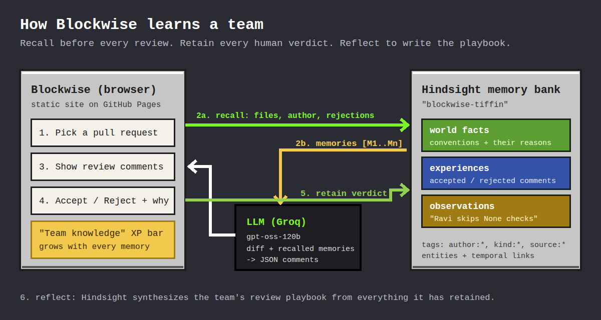

# Blockwise

**The code reviewer that remembers your team.**

Most AI code reviewers are brilliant strangers. They know Python, but they don't know that *your* team keeps money in integer paise, bans database calls inside route handlers, and has already told the bot three times to stop suggesting f-strings in logging calls.

Blockwise is a code review agent that learns those things. It uses [Hindsight agent memory](https://github.com/vectorize-io/hindsight) to remember past review threads, which suggestions the team accepted or rejected (and why), and which mistakes each developer tends to repeat. Every review starts by recalling that memory, and every human verdict is retained so the next review is better.



## What it does

- **Recalls before it reviews.** For each pull request, Blockwise runs three Hindsight recalls: conventions relevant to the files and code patterns in the diff, the author's review history, and suggestions the team has rejected.
- **Cites its memory.** Comments based on memory are highlighted in gold and show exactly which memories (and which original PR) they came from.
- **Stops nagging.** Reject a comment with a reason, and Blockwise retains it. The next review skips that suggestion.
- **Knows people, kindly.** If Ravi has skipped a `None` check twice before, Blockwise mentions it and names the earlier PRs.
- **Writes the team playbook.** Hindsight's `reflect` synthesizes everything learned into a readable review playbook.
- **Side-by-side mode.** Review the same PR with and without memory to see the difference in one screen.

## Try it

1. Get a free [Groq API key](https://console.groq.com/keys) and a [Hindsight Cloud](https://ui.hindsight.vectorize.io) API key.
2. Open the site and click **Settings**. Paste both keys and save.
3. Click **Teach team history**. Blockwise creates a memory bank and retains 8 past review threads from a sample food-delivery backend team (Tiffin). Wait until the XP bar stops growing.
4. Open **PR #112**, choose **Side by side**, and click **Review PR**.
5. Reject one comment with a reason, then run the review again: the suggestion is gone. Try **PR #114** too, a clean PR where memory keeps Blockwise quiet.
6. Open **Memory → Playbook** and click **Write playbook**.

Keys are stored only in your browser's localStorage and are sent only to the API URLs you configure.

## How Hindsight is used

| Operation | Where | What it does in Blockwise |
|---|---|---|
| `PUT /banks/{id}` | `js/hindsight.js → ensureBank()` | Creates the bank with a `retain_mission` that tells Hindsight to extract conventions, reasons, rejected suggestions and per-developer patterns. |
| **retain** | `js/app.js → seed()` | Stores 8 past review threads (async, with timestamps, `document_id`s and `author:*` / `kind:*` tags). |
| **retain** | `js/app.js → sendFeedback()` | Stores every Accept / Reject verdict, with the reviewer's reason, synchronously so the very next review sees it. |
| **recall** | `js/agent.js → recallForPR()` | Three parallel recalls per PR (files + code signals, author history, rejected suggestions), merged and deduplicated into `[M1..Mn]`. |
| **reflect** | `js/app.js → reflect()` | Produces the team's review playbook from everything retained. |
| list / stats | `js/app.js` | Drives the "Learned" panel and the Team knowledge XP bar. |

A longer write-up is in [docs/HINDSIGHT.md](docs/HINDSIGHT.md).

## Deploy to GitHub Pages

This is a static site with no build step.

1. Push this folder to a public GitHub repository (the files must be at the repository root).
2. Go to **Settings → Pages**, set **Source** to *Deploy from a branch*, choose `main` and `/ (root)`, and save.
3. After a minute your site is live at `https://<your-username>.github.io/<repo-name>/`.

The `.nojekyll` file makes GitHub serve every file as-is.

### If the browser can't reach Hindsight

If Blockwise shows *"Could not reach Hindsight"*, the browser is blocking the cross-origin request. Deploy the tiny proxy in [`proxy/cloudflare-worker.js`](proxy/cloudflare-worker.js) to a free Cloudflare Worker and paste its URL into **Settings → Hindsight API URL**. Instructions are at the top of the file.

### Local development

```bash
python3 -m http.server 8000
# open http://localhost:8000
```

You can also point Blockwise at a self-hosted Hindsight (for example `http://localhost:8888` from the Docker image) and leave the Hindsight key empty.

## Project structure

```
index.html              UI shell
css/style.css           Blocky pixel theme (bundled OFL fonts, no external requests)
js/app.js               UI controller: PR list, review flow, feedback, memory panel
js/agent.js             The agent: recall -> review -> retain feedback, and the prompts
js/hindsight.js         Minimal Hindsight HTTP client (bank, retain, recall, reflect, list, stats)
js/llm.js               OpenAI-compatible client (Groq default) with JSON-mode fallback
js/data.js              Sample team: 8 seed review threads and 3 demo pull requests
proxy/                  Optional CORS proxy for Hindsight Cloud
docs/                   Architecture diagram and Hindsight write-up
```

## Design decisions

- **Memory is scoped with tags, not separate banks.** One bank per team; `author:*` tags let recall pull one developer's history without losing team-wide conventions.
- **Feedback is retained synchronously.** Seeding uses async retain for speed, but a rejection must be visible to the very next review, so feedback waits for extraction.
- **The prompt forbids inventing conventions.** Memory-based comments must cite a memory ref, and refs the model makes up are filtered out before display.
- **Quiet on clean code.** The prompt tells the reviewer that a clean PR deserves few or zero comments. PR #114 exists to show this.

## Limitations

- Keys live in the browser, which is fine for a personal tool or a demo but not for a shared deployment. A production version would move the LLM and Hindsight calls behind a small backend and connect to GitHub via a webhook.
- The sample data is synthetic. To use Blockwise on a real team, retain your own past review threads using the same format as `js/data.js`.

## Links

- [Hindsight on GitHub](https://github.com/vectorize-io/hindsight)
- [Hindsight documentation](https://hindsight.vectorize.io/)
- [What is agent memory?](https://vectorize.io/what-is-agent-memory)

## License

MIT. Fonts are under the SIL Open Font License.
